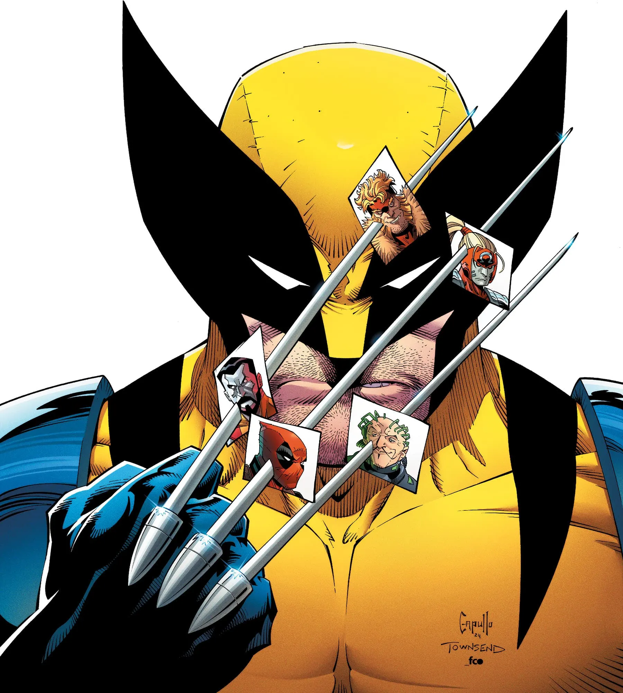

## Wolverine
Here is my link (https://www.google.com)
 "Wolverine is part of the Xmen representing a brave hero /
who also is a icon representing the University of Michigan ,but it is not the mascot(UofM does not like this term)

